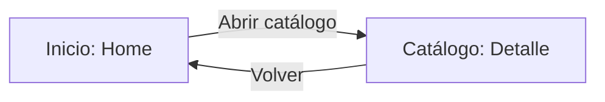
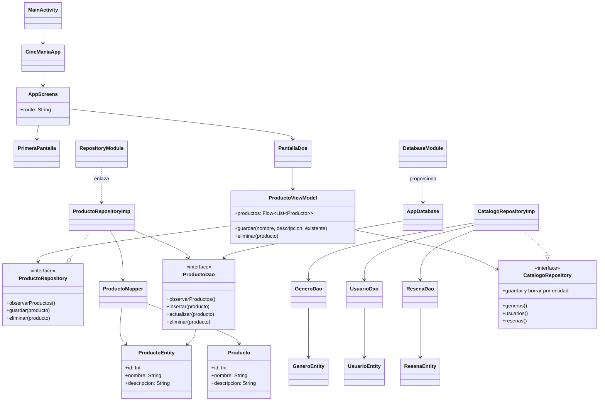
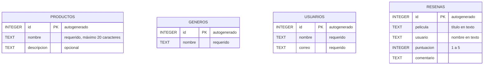
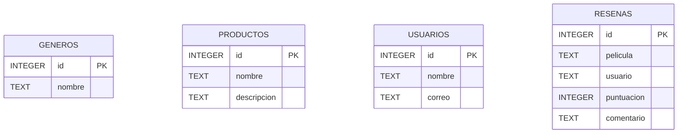

# CineMania - documentación y entrega de Unidad 3

**Proyecto:** aplicación móvil Android para administrar un catálogo local de películas/productos de CineMania.  
**Tecnología observada en el código:** Kotlin, Jetpack Compose, Navigation Compose, Room, Kotlin Flow, Hilt y KSP.  
**Estado de esta entrega:** dos pantallas y CRUD persistente implementado con Room para cuatro entidades: `productos`, `generos`, `usuarios` y `resenas`. La interfaz incluye pestañas para realizar altas, consultas, ediciones y eliminaciones. El repositorio remoto y la evidencia de ejecución en dispositivo siguen pendientes.

> Este documento separa los criterios indicados por la evaluación de las funciones que actualmente se pueden comprobar en el código. Las propuestas futuras se identifican expresamente como tales.

## 1. Descripción del proyecto

CineMania es una aplicación Android de catálogo. La pantalla de inicio presenta la identidad del proyecto y permite abrir el catálogo. La pantalla de catálogo muestra registros guardados localmente y permite agregar, consultar, editar y eliminar registros. La persistencia usa Room sobre SQLite.

## 2. Alcance de la primera etapa

### Incluido

- Aplicación nativa para Android, con `minSdk 24`.
- Pantalla de bienvenida y pantalla de catálogo, con navegación entre ambas.
- Captura de nombre (máximo 20 caracteres) y descripción.
- Persistencia local de `productos`, `generos`, `usuarios` y `resenas` con Room.
- Operaciones insertar, consultar/observar, actualizar y eliminar en las cuatro tablas.
- Migración de esquema Room de versión 1 a 2.
- Interfaz declarativa con Jetpack Compose y patrón de separación por capas (UI, dominio y datos).

### Fuera del alcance actual

- Cuentas, autenticación, sincronización remota, compras/boletos, calificaciones y recomendaciones.
- Uso de sensores del teléfono en producción.
- Relaciones por clave foránea entre entidades: las reseñas guardan película y usuario como texto libre en esta versión.
- Publicación en tienda y validación documentada en un dispositivo físico.

## 3. Pantallas y navegación

1. **Inicio (`Home`)**: logotipo, nombre y descripción breve; botón para abrir el catálogo.
2. **Catálogo (`Detalle`)**: formulario de nombre y descripción, lista de registros, acciones de edición y borrado, y navegación de regreso.



## 4. Diagrama de clases

El diagrama representa las clases observadas en el código de la aplicación y las relaciones principales entre presentación, dominio y persistencia.



## 5. Modelo de datos

### Esquema implementado

La base local contiene cuatro tablas. `productos` usa un identificador entero autogenerado, nombre de hasta 20 caracteres y descripción opcional. Las demás entidades tienen identificador autogenerado y campos requeridos según su modelo.



| Tabla | Campo | Tipo | Regla |
|---|---|---|---|
| productos | id | INTEGER | Clave primaria autogenerada |
| productos | nombre | TEXT | Requerido; máximo 20 caracteres validado en la entidad y formulario |
| productos | descripcion | TEXT | Opcional; valor inicial vacío |
| generos | id | INTEGER | Clave primaria autogenerada |
| generos | nombre | TEXT | Requerido |
| usuarios | id | INTEGER | Clave primaria autogenerada |
| usuarios | nombre, correo | TEXT, TEXT | Requeridos; correo con formato validado |
| resenas | id | INTEGER | Clave primaria autogenerada |
| resenas | pelicula, usuario | TEXT, TEXT | Requeridos; referencias descriptivas en texto |
| resenas | puntuacion | INTEGER | Entero entre 1 y 5 |
| resenas | comentario | TEXT | Comentario de la reseña |

### Esquema implementado y relación lógica

La Revisión 3 pide dos tablas y la Revisión 4 pide conexión y CRUD con **4 entidades** usando Room. El esquema implementado tiene las cuatro tablas siguientes. `ResenaEntity` guarda el título de película y nombre de usuario como texto libre; no existe integridad referencial mediante claves foráneas.



`GeneroEntity`, `ProductoEntity`, `UsuarioEntity` y `ResenaEntity` están declaradas en Room y registradas en `AppDatabase`. Cada tabla tiene DAO con `Flow`, `@Insert`, `@Update` y `@Delete`; el repositorio expone las operaciones y la pantalla ofrece formularios y listados con edición y eliminación. Los nombres en reseñas son texto libre y no garantizan que coincidan con un registro existente.

## 6. Recursos multimedia

Una aplicación móvil puede integrar imágenes, audio, video, animaciones, iconografía e ilustraciones. En CineMania se observan recursos de imagen para marca e icono: `logo_cinemania.xml` y los recursos `ic_launcher`. La UI usa `Image` de Compose para mostrar el logotipo. No se observan reproductores de audio/video ni animaciones multimedia en la etapa actual.

La identidad visual se integra como recurso local, por lo que no requiere permiso de red ni carga desde un servidor. El catálogo actual no muestra carátulas individuales por registro.

## 7. Sensor propuesto

Se propone integrar el **acelerómetro** para permitir una interacción opcional de “agitar para sugerir una película” cuando el catálogo tenga varios registros. Es una opción coherente con una app recreativa y funciona sin compartir ubicación. En esta etapa es solo una propuesta: el manifiesto no declara permisos de sensores y el código no registra un `SensorEventListener`.

Para implementarlo, se consultaría `SensorManager` y el sensor `TYPE_ACCELEROMETER`, se registraría el listener solo mientras la pantalla correspondiente esté activa y se liberaría en `onPause`/`onDispose`. La detección debería usar umbral y enfriamiento temporal para evitar activaciones repetidas. Si el sensor no existe, la función debe permanecer disponible por botón.

## 8. Librerías y toolkit observados

| Librería/toolkit | Uso en el proyecto |
|---|---|
| Kotlin | Lenguaje principal de la app y modelos. |
| Android Gradle Plugin | Configura compilación, empaquetado y variantes Android. |
| Jetpack Compose (UI, Material 3, Activity Compose) | Construye pantallas declarativas, componentes y tema visual. |
| Navigation Compose | Navega entre las rutas `Home` y `Detalle`. |
| Room Runtime + Room KTX | Persistencia SQLite y consultas observables con Flow. |
| KSP + Room Compiler | Genera el código de Room durante la compilación. |
| Kotlin Coroutines / Flow | Expone cambios de datos de forma asíncrona y reactiva. |
| Hilt + Hilt Navigation Compose | Inyección de dependencias en la app y acceso al ViewModel desde Compose. |
| AndroidX Lifecycle Runtime Compose | Integra estado del ciclo de vida con la UI Compose. |
| AndroidX Core KTX | Extensiones Kotlin para APIs Android. |
| JUnit, AndroidX JUnit, Espresso y Compose UI Test | Dependencias configuradas para pruebas unitarias, instrumentadas y de interfaz; su presencia no acredita por sí sola que se hayan ejecutado. |

## 9. Seguridad en Android/Kotlin

Medidas aplicables al proyecto:

- Solicitar solo permisos necesarios. La app actual no declara permisos en el manifiesto.
- Mantener `android:allowBackup` y reglas de extracción alineadas con la sensibilidad de los datos. El catálogo no maneja credenciales; si luego se guardan datos sensibles, excluirlos del backup o proteger el flujo de respaldo.
- No incluir claves privadas, contraseñas ni tokens en el código fuente. Para secretos de backend, usar almacenamiento/gestión del lado servidor y tokens de corta duración.
- Si se incorpora comunicación remota, usar HTTPS/TLS y rechazar tráfico en claro; validar certificados con las prácticas estándar de Android.
- Validar entradas (el nombre ya tiene límite) y usar consultas parametrizadas de Room en vez de concatenar SQL.
- Guardar preferencias o credenciales sensibles con Android Keystore mediante una biblioteca de cifrado adecuada; Room por sí solo no cifra la base de datos.
- Reducir datos personales recolectados y definir retención/eliminación. Aplicar controles de acceso en backend si se añaden cuentas.
- Mantener dependencias actualizadas, revisar permisos y evitar registrar datos privados en Logcat.
- Configurar endurecimiento de versión de lanzamiento (minificación/optimización y firma protegida) antes de distribución; el build actual desactiva optimización en `release`.

## 10. Repositorio y control de versiones

Git registra cambios por commits, permite comparar versiones y restaurar estados previos. El proyecto ya queda inicializado como repositorio Git local; el paso pendiente es crear un repositorio remoto en GitHub y publicar la rama `main`. **URL del repositorio remoto: pendiente de crear.** No se inventa un enlace.

Para compilar localmente, abre el proyecto en Android Studio y ejecuta la variante `app`/`debug`, o usa `gradlew.bat assembleDebug` en Windows con Android SDK configurado.

Comandos sugeridos desde la raíz del proyecto:

```bash
git init
git add .
git commit -m "Entrega inicial de CineMania"
git branch -M main
git remote add origin https://github.com/USUARIO/REPOSITORIO.git
git push -u origin main
```

Reemplazar `USUARIO/REPOSITORIO` por el destino real antes de ejecutar los dos últimos comandos.

## 11. Criterios de evaluación y estado

### Criterio 1 - Lista de cotejo / verificación (30%)

| Requisito | Evidencia actual / acción necesaria |
|---|---|
| Continuidad de la documentación de Unidad 2 | Esta documentación describe la etapa actual de CineMania; integrar aquí el reporte de Unidad 2 si se requiere continuidad literal. |
| Definir alcance de esta etapa | Documentado en la sección 2. |
| Diagrama de clases | Incluido en la sección 4. |
| Modelo de datos | Cuatro entidades Room implementadas y descritas en la sección 5. |
| Recursos multimedia y uso | Documentado en la sección 6. |
| Sensor y justificación | Acelerómetro propuesto; implementación pendiente, sección 7. |
| Librerías/toolkits | Documentados según dependencias configuradas, sección 8. |
| Seguridad para Android/Kotlin | Medidas aplicables y límites actuales, sección 9. |
| Sistema de control de versiones y utilidad | Git permite registrar cambios y volver a versiones previas; repositorio remoto y URL siguen pendientes, sección 10. |

### Criterio 2 - Desarrollo del proyecto (60%)

La rúbrica describe tres revisiones periódicas de 10% y una revisión final de 30%:

| Revisión | Criterio | Estado comprobable |
|---|---|---|
| 1 (10%) | Creación y tema del proyecto | Proyecto Android CineMania presente. |
| 2 (10%) | Dos pantallas | Inicio y catálogo implementados. |
| 3 (10%) | Dos tablas y CRUD | Implementado en alcance: cuatro tablas Room con operaciones CRUD desde la pantalla de catálogo. Requiere demostración práctica. |
| 4 (30%) | Funcionalidad (30%), sintaxis/arquitectura/patrones (30%), cuestionario (40%) | El código ya incluye cuatro entidades CRUD, manejo de entradas no válidas con mensajes y arquitectura UI/ViewModel/Repository/DAO. Falta validar instalación, giro, ejecución y preparar/exponer el cuestionario; el puntaje depende de la demostración y las respuestas. |

### Presentación del proyecto (10%)

La rúbrica solicita presentar la app de Unidad 3 y validar su funcionamiento desde un dispositivo Android. Esta validación requiere ejecutar la app en dispositivo físico o emulador Android y conservar evidencia (capturas/video breve o acta de demostración). No se afirma que se haya realizado desde este entorno.

La escala visible en la rúbrica considera especialmente que la app esté instalada en un teléfono Android, funcione correctamente, conserve el estado al girar la pantalla y muestre correctamente sus controles. Un AVD con Android cuenta como alternativa de validación para la rúbrica final. La selección de pestaña y campos de los formularios usan `rememberSaveable`; aun así, se debe confirmar en ejecución que el estado y la disposición se conservan al girar.

## 12. Revisión 4: guía del cuestionario oral

La rúbrica indica que se extraen seis preguntas al azar. Estas respuestas breves son material de estudio y deben contrastarse con la implementación final antes de la exposición. Las preguntas repetidas en la hoja se conservan para corresponder con su numeración.

1. **¿Qué es Android?** Sistema operativo móvil basado en Linux y plataforma de software de Google para ejecutar aplicaciones en dispositivos móviles.
2. **¿Qué es Jetpack Compose?** Toolkit declarativo de Android para construir interfaces nativas con funciones Kotlin anotadas con `@Composable`.
3. **¿Estás implementando un framework y cuál o cuáles usas?** La app usa Android Jetpack: Compose para UI, Navigation Compose para navegación, Room para persistencia y AndroidX Lifecycle. Hilt aporta inyección de dependencias.
4. **¿Qué librerías usas y dónde se declaran o implementan?** Las dependencias están en `app/build.gradle.kts`; versiones y alias se centralizan en `gradle/libs.versions.toml`. Se consumen en fuentes Kotlin, por ejemplo Compose en pantallas y Room en `data/`.
5. **¿Por qué el patrón Singleton no puede generar más de una instancia?** Su propósito es restringir una clase a una única instancia compartida, normalmente con constructor privado y un punto de acceso global. En esta app, Room crea la base con `Room.databaseBuilder` provisto por Hilt; revisar `DatabaseModule.kt` para explicar el alcance concreto. Singleton no significa que toda clase deba ser única.
6. **Explica el patrón UDF y dónde lo implementas en tu código.** UDF (flujo unidireccional de datos) separa el estado que baja hacia la UI de los eventos que suben desde ella. En la app, `ProductoViewModel` expone productos mediante `Flow` y las acciones de la pantalla llaman funciones del ViewModel. La versión actual es sencilla; confirmar el flujo completo en `PantallaDos.kt` y `ProductoViewModel.kt`.
7. **Explica el patrón Observer y dónde lo implementas en tu código.** Observer notifica a suscriptores cuando cambia un valor. Room entrega `Flow<List<ProductoEntity>>`; el repositorio/ViewModel lo mapea y Compose lo observa para recomponer la lista cuando los datos cambian.
8. **Explica el patrón Inyección de dependencias y dónde lo implementas en tu código.** En vez de crear dependencias dentro de cada consumidor, un contenedor las construye y proporciona. Hilt está configurado en `CineManiaApp`, `DatabaseModule.kt` y `RepositoryModule.kt`; `ProductoViewModel` recibe su repositorio por constructor.
9. **Explica el patrón Repository y dónde lo implementas en tu código.** El repositorio ofrece una API de dominio y oculta detalles de Room/DAO. `ProductoRepository` define el contrato y `ProductoRepositoryImp` implementa el acceso a `ProductoDao`, con conversión mediante `ProductoMapper`.
10. **Explica UDF y dónde lo implementas.** Misma respuesta de la pregunta 6: el estado de catálogo fluye hacia la UI y las acciones de usuario se envían al ViewModel.
11. **¿Qué es una función suspend y dónde la implementas?** Es una función Kotlin diseñada para suspenderse sin bloquear el hilo mientras espera una operación asíncrona, normalmente dentro de una coroutine. Las operaciones de escritura de `ProductoDao` (`insertar`, `actualizar`, `eliminar`) son `suspend`.
12. **¿Qué anotaciones se usan para implementar Room?** `@Database` identifica la base y sus entidades; `@Entity` declara una tabla; `@PrimaryKey` la clave primaria; `@Dao` el objeto de acceso; `@Query`, `@Insert`, `@Update`, `@Delete` declaran operaciones.
13. **¿Qué es un ViewModel y cómo lo implementas?** Conserva/prepara estado de UI y sobrevive a cambios de configuración mediante el ciclo de vida. `ProductoViewModel` coordina el catálogo con el repositorio; en Compose se obtiene con `hiltViewModel()` en `PantallaDos`.
14. **Explica SOLID y cómo lo implementas.** SOLID reúne cinco principios: responsabilidad única, abierto/cerrado, sustitución de Liskov, segregación de interfaces e inversión de dependencias. La separación UI/ViewModel/repositorio/DAO y el contrato `ProductoRepository` apoyan responsabilidad única e inversión de dependencias. No afirmar cumplimiento total sin revisar todas las clases.
15. **¿Para qué sirve `@AndroidEntryPoint` y dónde se implementa?** Marca un componente Android como punto de integración de Hilt para recibir dependencias. Revisar `MainActivity.kt`; en esta app se anota el punto de entrada Android si Hilt inyecta allí o en destinos asociados.
16. **¿Para qué sirven `NavHost` y `NavGraphBuilder`?** `NavHost` contiene el grafo y muestra el destino actual; las extensiones de `NavGraphBuilder` declaran destinos y rutas. La navegación de `Home` y `Detalle` se configura en `AppNavegacion.kt`.
17. **¿Para qué sirven `@Dao` y `@Entity`?** `@Dao` marca operaciones de acceso a datos para que Room genere implementación; `@Entity` convierte una clase Kotlin en definición de tabla. Están en `ProductoDao.kt` y `ProductoEntity.kt`.
18. **¿Qué es una función de extensión y cómo la implementas?** Añade una función a una API existente sin modificar su clase, usando un receptor. En `ProductoMapper.kt`, `fun ProductoEntity.toDomain()` y `fun Producto.toEntity()` son funciones de extensión que convierten entre el modelo de Room y el modelo de dominio.
19. **¿Cuál es el punto de entrada de una aplicación Android?** Android inicia un componente declarado en el manifiesto. En esta app el `MainActivity` con filtro `MAIN`/`LAUNCHER` es la actividad de entrada.
20. **¿Cómo se declara una función en Kotlin? Explica la sintaxis y cómo se implementa.** Se usa `fun nombre(parametros): TipoRetorno { ... }`; una función suspend agrega `suspend`, una función de expresión puede usar `=`, y una función composable lleva `@Composable`. Ejemplo: `suspend fun insertar(producto: ProductoEntity)` en `ProductoDao`.
21. **¿Para qué sirve `@HiltAndroidApp` y dónde se implementa?** Genera/configura el contenedor de Hilt para la aplicación. Se coloca en la subclase `Application`, aquí `CineManiaApp.kt`.
22. **¿Diferencia entre `@Preview` y `@Composable`?** `@Composable` marca una función que puede emitir UI Compose; `@Preview` permite renderizar una vista previa en el IDE, normalmente sobre una función composable. No son intercambiables.
23. **¿Cómo declaramos una interfaz de usuario en Jetpack Compose?** Componiendo funciones `@Composable` que describen UI según estado y usan componentes/layouts como `Scaffold`, `Column`, `Text` y `Button`; en el proyecto, `PrimeraPantalla` y `PantallaDos` son ejemplos.
24. **¿Qué lenguaje de programación ocupas?** Kotlin.
25. **¿Diferencia entre `stringResource()` y `painterResource()` y dónde se implementan?** `stringResource(R.string...)` carga texto desde `res/values/strings.xml`; `painterResource(R.drawable...)` carga un drawable para dibujarlo. Se usan respectivamente para títulos/etiquetas y el logotipo en las pantallas.
26. **¿Dónde puedes ver la versión de la API de Android con que generaste tu proyecto?** En `app/build.gradle.kts`, dentro de `defaultConfig`: `minSdk`, `targetSdk`; `compileSdk` indica la API contra la que se compila. En el estado actual se declara `minSdk 24`, `targetSdk 37` y `compileSdk 37`.

## 13. Evidencia sugerida para la entrega

- Captura de inicio y catálogo en Android.
- Evidencia de insertar, consultar, actualizar y eliminar datos.
- Para Revisión 3, repetir las operaciones CRUD al menos en dos pestañas; la app dispone actualmente de cuatro entidades.
- URL pública o accesible al docente del repositorio con historial de versiones.
- Para la presentación (10%), demostración ejecutada en dispositivo Android y evidencia legible.
